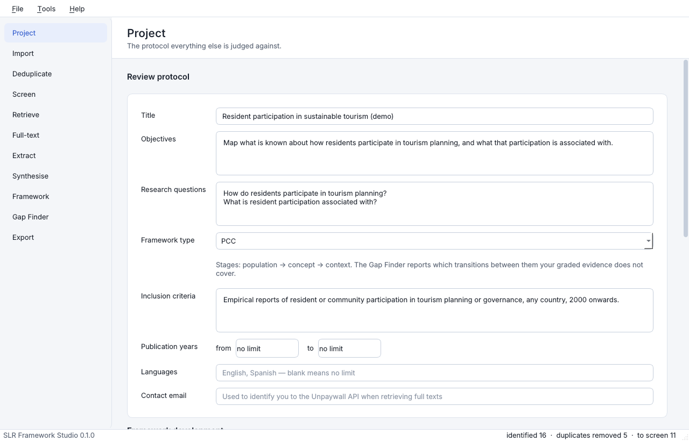
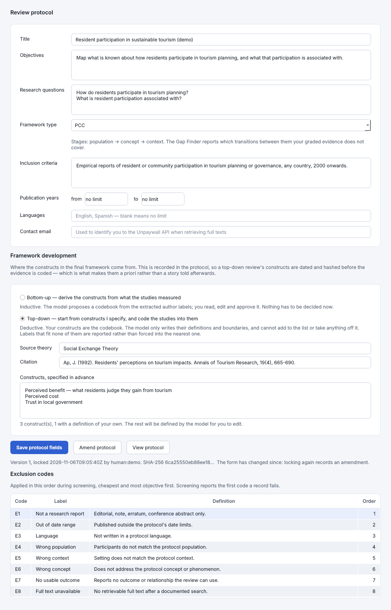
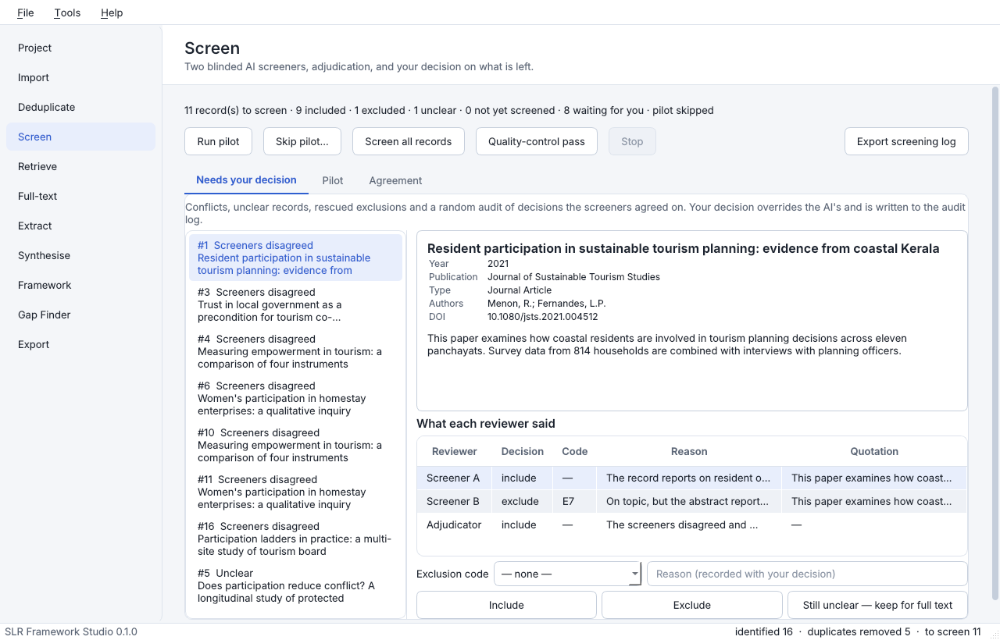
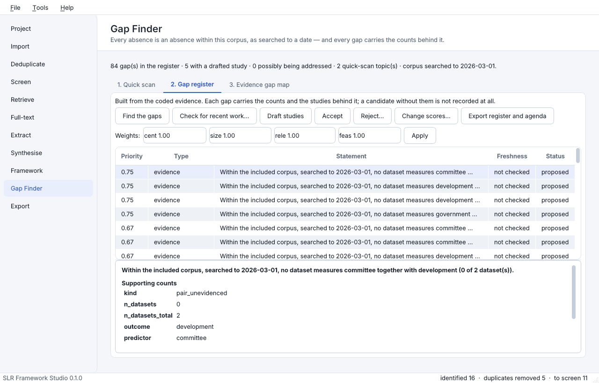

# SLR Framework Studio

A Windows desktop application that takes a systematic review from database
exports to an evidence-graded theoretical framework, following PRISMA 2020 and
keeping a full audit trail.

AI makes the first pass at every stage. A human confirms or overrides each
decision before it counts, and every decision of either kind is written to an
append-only log that the Methods section is later generated from.

**Status: complete.** All eight build stages are done, covering Sections 1
to 14 of the specification. Every stage in the navigator is built; there are
no placeholders left. The roadmap modules in Section 15 are a separate
programme and are not started.

The specification the build follows is `docs/SPEC.md`, versioned alongside the
code.

---

## Getting started

### Step 1 — Get the application

**If you downloaded a release:** extract the zip, then right-click it first,
choose **Properties**, tick **Unblock**, and extract. Windows marks anything
downloaded from the internet, and without that step SmartScreen refuses to run
it. Then run `SLRFrameworkStudio.exe` from the extracted folder. The whole
folder is the program — move the folder, not just the `.exe`.

**If you have the source:** double-click `packaging\build-windows.bat`. It
makes its own virtual environment, so it will not disturb any Python you use
for other work, and it checks the executable it built actually runs before
telling you it worked. Two to five minutes.

You do not need to install Python for the first option, and you need nothing
else for either.

### Step 2 — Try it with no API key, no internet and no risk

Open the application and choose **Tools → Build demonstration project…**, then
point it at a new empty folder.

This builds a complete small review from end to end — import, deduplication,
screening, retrieval, full-text eligibility, extraction, synthesis, framework
and gap register — in about a minute. It costs nothing, needs no API key and
reaches the internet not at all: the decisions are made by a mock model that
follows keyword rules.

It is the fastest way to see what every stage produces before committing your
own corpus to it. **Nothing in it is a finding about anything.** Its studies
are invented and its PDFs are generated.

### Step 3 — Start your own review

**File → New review…**, then fill in the Project page and lock the protocol.



Two fields decide how the rest of the review behaves, and they answer
different questions:

- **Framework type** — the shape of your *question*. PICO for effectiveness,
  PCC for a scoping review, SPIDER for qualitative work, CIMO for management
  research, and nine more. If your field uses one that isn't listed, choose
  *Define a framework of my own…* and give it its stages. The stages are not
  decoration: the Gap Finder reports which transitions between them your
  evidence does not cover.
- **Framework development** — where the constructs in your final framework
  come from. *Bottom-up* derives them from what the included studies turned
  out to measure. *Top-down* starts from constructs you specify in advance,
  from theory, and codes the studies into them.



If you choose top-down, name the theory and cite it. Those constructs are
written into the protocol document, which is hashed and timestamped when you
lock it — which is what makes them *a priori* rather than a story told
afterwards. Change them later and the application requires an amendment with
a reason, and reports it in the Methods section.

Then **Draft and lock protocol**. Screening will not start without a locked
protocol, so that every decision can be traced to the exact wording it was
judged against.

### Step 4 — Work the stages in order

The navigator down the left is the review. Each stage opens when the one
before it has produced what it needs.

| Stage | What you do |
|---|---|
| **Import** | Drop in your database exports — RIS from Scopus, Web of Science, EBSCO or ProQuest, PubMed `.nbib`, EndNote XML, CSV. Add seed studies you already know should be found, and it tells you whether your search found them. |
| **Deduplicate** | Confirm or overturn the matches it proposes. Anything it is unsure of comes to you side by side. |
| **Screen** | Pilot against your own labels first, so you can see where you and the model disagree before it screens 2,000 records. Then two blinded AI screeners, adjudication, and a queue of everything needing a human. |
| **Retrieve** | Finds open-access copies through Unpaywall and matches PDFs you supply. It does not touch paywalled sites, use your institutional credentials, or scrape. |
| **Full-text** | Each report assessed against your exclusion codes in order, with every quotation checked against the page it cites. |
| **Extract** | The authors' own labels for what they measured, with page numbers and quotations, plus a blind direction check and an optional second coder. |
| **Synthesise** | Approve a construct codebook, map labels onto it, and get vote-counted grades with confidence intervals, sensitivity analyses and a contradiction table. |
| **Framework** | Themes, propositions with mechanisms and falsifying tests, and an integrated diagram as SVG, PNG, PDF and editable PowerPoint. |
| **Gap Finder** | Seven kinds of gap built from the coded evidence, each carrying the counts and studies behind it, ranked on four criteria you can reweight. |
| **Export** | Everything in one action, including the PRISMA diagram, the screening log, the extraction matrix, the Methods draft and the audit log. |





### Step 5 — Connect a model

For a real review you need an API key from a model provider. **Tools → Model
settings…** Keys are stored in the Windows Credential Manager, never in a file
and never in the project.

Before any bulk run the application shows what it will cost, in tokens and
money, and waits for you to agree. Runs can be paused and resumed.

### What you will need before you start

- Your database exports, as files on disk.
- The date your searches were last run. Every claim of absence the Gap Finder
  makes is qualified against it, and it is yours to state — the application
  never infers it from when the software happened to run.
- An API key, unless you are only running the demonstration.
- Your eligibility criteria, in words you are prepared to be held to.

---

## What works now

| Stage | State |
|---|---|
| Project | Protocol fields and exclusion-code ladder; the protocol document is drafted, locked with a timestamp and SHA-256 hash, and every later change recorded in an amendment log. Seed studies. Whether the framework is built bottom-up from what the studies measured or top-down from constructs you specify in advance — the choice is written into the protocol, so a top-down review's constructs are dated and hashed before any evidence is coded, along with the theory they are drawn from and its citation. Thirteen question frameworks (PICO, PICOS, PICOT, PECO, PEO, PCC, CoCoPop, SPIDER, SPICE, ECLIPSE, CIMO, SOBC, PIRD) and any you define yourself by naming its stages — the stages are required, because they are what the Gap Finder looks for transitions between. |
| Import | RIS (Scopus, Web of Science, EBSCO, ProQuest, generic), PubMed `.nbib`, EndNote XML, CSV/TSV. Per-file and per-database counts, missing-abstract flags, seed recall. |
| Deduplicate | DOI, then title plus year, then fuzzy title. Side-by-side review queue, merge logging, source-database provenance preserved. |
| Screen | Pilot against your own labels, two blinded AI screeners, adjudication, quality-control re-read, κ and PABAK, human review queue, Excel screening log. |
| Retrieve | Open-access locations through Unpaywall, PDFs matched by DOI then title, manual matching, retrieved / not retrieved / abstract only with reasons. |
| Full-text | Each report assessed against the ordered codes, every quotation checked against the page it cites, borderline cases queued for you. |
| Extract | Per-report and per-relationship extraction with the authors' own labels, the experiment rule, a blind direction check, a second coder, and the Excel extraction matrix. |
| Synthesise | A construct codebook — derived from the extracted labels, or written against the constructs your protocol declares — which you approve before anything is mapped, label mapping by what was measured, one reference orientation per construct with every sign flip logged, shared samples collapsed so a dataset votes once, vote-counted grades with Wilson intervals and an exact sign test, five sensitivity analyses, and a contradiction table. |
| Framework | Constructs grouped into themes, one evidence map per theme drawn from graded links only, propositions with a mechanism, moderators, boundary conditions and a falsifying test, and an integrated diagram. Each figure is written as SVG, PNG and editable PowerPoint. |
| Gap Finder | A quick scan that clusters the imported records before the review proper, and a full analysis afterwards building seven kinds of gap from the coded evidence. Every gap carries its counts and studies, is qualified to this corpus and its search date, is ranked on four criteria you can reweight, and can be checked against OpenAlex and Crossref for work that may already close it. |
| Export | Everything in one action: the PRISMA flow diagram in Word and PDF, a pre-filled PRISMA checklist, the screening log and extraction matrix, RIS files, a REFI-QDA project carrying the codings, the synthesis tables in Excel and Word, the gap register and research agenda, every figure in four formats, a Methods draft with its AI-use statement, and the full audit log with its verification. |

## Running it

**From source**

```bash
pip install -e ".[gui,dev]"
slr-studio                  # the desktop application
```

**Headless**, for scripting, continuous integration or support work. The
acceptance test says a reviewer never needs a terminal, and they never do;
this exists so the same code paths can be driven without a display.

```bash
slr new  C:\Reviews\tourism --title "Resident participation in tourism"
slr import C:\Reviews\tourism scopus.ris wos.ris --seed 10.1080/jsts.2021.004512
slr dedup C:\Reviews\tourism
slr pairs C:\Reviews\tourism          # duplicate pairs needing a human
slr decide C:\Reviews\tourism 3 distinct --reason "conference vs journal version"

slr protocol C:\Reviews\tourism --lock
slr screen  C:\Reviews\tourism --qc   # shows the cost and asks before spending
slr queue   C:\Reviews\tourism        # records needing a human decision
slr decide-record C:\Reviews\tourism 42 exclude --code E4 --reason "wrong population"
slr export-log C:\Reviews\tourism

slr retrieve C:\Reviews\tourism --find-open-access
slr retrieve C:\Reviews\tourism --add downloads\*.pdf
slr retrieve C:\Reviews\tourism --mark 42 not_retrieved --reason "no copy held"
slr fulltext C:\Reviews\tourism      # assesses every retrieved report

slr extract C:\Reviews\tourism --second-coder-sample
slr coders  C:\Reviews\tourism        # inter-coder agreement, field by field
slr export-matrix C:\Reviews\tourism

slr synthesise C:\Reviews\tourism     # codebook, mapping, datasets, grades
slr synthesise C:\Reviews\tourism --step grade
slr export-inventory C:\Reviews\tourism

slr framework C:\Reviews\tourism      # themes, propositions, figures
slr framework C:\Reviews\tourism --step evidence_maps

slr gaps C:\Reviews\tourism --step quick    # scoping scan, before screening
slr gaps C:\Reviews\tourism                 # the full analysis
slr gaps C:\Reviews\tourism --step freshness
slr export-gaps C:\Reviews\tourism

slr export-all C:\Reviews\tourism    # everything Section 12 lists

slr status C:\Reviews\tourism         # counts, and whether the audit chain is intact
```

Three steps of the synthesis are the reviewer's own — approving the codebook,
orienting each construct, confirming that two reports share a sample — and
`slr synthesise` stops at whichever comes first, saying what is waiting and
exiting 1 rather than 0. Passing `--accept-proposals` takes the model's answer
for all three, and logs each as accepted without being read, which is what
makes the demonstration project's grades unusable as findings.

**The bundled demo**

```python
from slr_studio.demo import build_demo_project
build_demo_project("demo-review", gaps=True)  # the whole pipeline, no API key
```

Four synthetic exports with the overlaps a real search produces. The
references are invented and must never be cited. Three sample PDFs come with
it, also invented, written so the full-text stage has something real to read:
a methods section, a findings section, and one page with no text layer so the
OCR path is exercised. Each is stamped as a synthetic sample on its first
page.

With `fulltext=True` the whole pipeline runs against the built-in offline
screener, whose answers come from keyword rules and are recorded as such — a
demo run cannot be mistaken for a real one.

## Building the Windows installer

Build on Windows, with Python 3.12:

```bat
pip install -e .[gui,dev]
pyinstaller packaging\slr_studio.spec --noconfirm
iscc packaging\installer.iss
```

The result is `dist\installer\SLRFrameworkStudio-0.1.0-setup.exe`, a per-user
install that needs no administrator rights. Put a Windows Tesseract build in
`packaging\vendor\tesseract` before building so OCR is bundled.

## How a project is stored

```
My Review/
  project.slr      one SQLite database: records, decisions, audit log
  imports/         verbatim copies of every file imported
  pdfs/            full texts
  figures/         evidence maps and framework diagrams
  exports/         PRISMA diagram, screening log, extraction matrix
```

Nothing leaves the computer except the calls you choose to make to a language
model. `project.slr` is plain SQLite: it can be opened in any SQLite browser
years from now, which is the point.

## Deduplication, in detail

Three rules, applied in order of how much they prove:

1. **Exact DOI.** A shared DOI is the same work. Merged automatically, even if
   the years disagree, because online-first and issue versions differ.
2. **Normalised title plus year within ±1.** Titles are compared with case,
   punctuation, accents and markup stripped. A missing year never blocks a
   match, because a missing value cannot contradict anything.
3. **Fuzzy title similarity** above a threshold you set (0.92 by default).
   Merged without asking only above a second threshold (0.97) *and* with the
   same first author; everything between the two goes to the review queue.

Two records with the **same title but different DOIs** are never merged
automatically, whatever the similarity. That pattern is usually a conference
paper later published as an article, a correction, or a reprint, and the
choice belongs to a reviewer.

Matching is transitive: if A matches B and B matches C, all three are one
study. When a chain like that pulls in a pair a reviewer marked as distinct,
the run reports the contradiction instead of silently picking a side.

Re-running rebuilds the whole picture from the records and the stored
decisions, so changing a threshold cannot leave a stale merge behind. Human
decisions survive every re-run; automatic ones are recomputed.

## The protocol

Version 1 is drafted from the project form and locked with a timestamp and a
SHA-256 hash. The document is a pure function of the form — there is no
timestamp in its body — so a changed hash means a changed protocol rather than
a different minute.

Every later lock records an amendment with its reason, a diff, and whether it
was made **after the data were seen**. That flag is observed, not
self-reported: it is true once any record has been imported. **Tools → Verify
audit trail** recomputes every stored protocol hash alongside the audit chain.

Screening refuses to run until the protocol is locked, so that every decision
can be traced to the exact wording it was judged against.

## Screening

Five steps, each committed before the next begins, so a run that is paused or
interrupted resumes without re-asking anything:

1. **Pilot.** You label a reproducible random sample by hand; the AI screens
   the same records; agreement is reported. The full run is blocked until this
   has happened or been waived with a reason, which is logged.
2. **Two blinded screeners.** Each record is judged twice by personas that
   differ in what they do with ambiguity — one prefers to include, the other
   answers "unclear". Neither sees the other's answer, the source database, or
   anything about the review's progress. Temperature is 0 throughout: two
   screeners differ because their instructions differ, not because the sampler
   did.
3. **Adjudication.** A third call settles include-versus-exclude
   disagreements. Unclear against a definite answer is not adjudicated — that
   is already a question for a human.
4. **Quality control.** A reproducible sample of the records both screeners
   excluded, plus every exclusion that trips two keyword signals drawn from
   the protocol's own criteria, is read again. A rescue never reverses the
   exclusion by itself; it queues the record for a human.
5. **Your decision.** Conflicts, unclear records, QC rescues and a random
   audit of agreed decisions. Your answer always wins and is logged as an
   override.

Every exclusion names the **first** code it failed, which is what the PRISMA
"excluded, with reasons" box reports. Every quotation is checked against the
record it came from; one that is not found is stored flagged and marked in the
Excel log, because a screener that invents a supporting quotation has invented
its reasoning.

Agreement is reported three ways. Percentage agreement flatters any screening
process when most records are obvious excludes; κ corrects for chance; PABAK
corrects κ's own collapse when one category dominates, which is the everyday
situation in a review. κ is reported as *undefined*, never as zero, when both
reviewers used a single category.

## Retrieval

The app finds links. It does not download from paywalled hosts, use your
institutional credentials, solve CAPTCHAs or scrape publishers. Unpaywall is
queried by DOI with your own email address, as its terms require, and returns
where a free copy is published; you follow the link, decide whether you may
read it, and save the file. A tool that fetched PDFs on your behalf would be
making a licensing judgement it is in no position to make.

Dropped PDFs are matched to records by the DOI printed in the file, then by
title. A DOI match is decisive and no title score overrides it. A title match
attaches only above 0.93 similarity; anything less goes to a manual screen
with the closest record pre-selected, because a PDF filed against the wrong
study is worse than one filed against none — it will be read, assessed and
quoted as if it were the right paper.

Reports that cannot be found are tracked as not retrieved or abstract only,
and both require a reason. PRISMA asks for the reports not retrieved; a count
without reasons cannot be defended.

## Reading a PDF

Text layers are read with PyMuPDF. A page with no usable text — a scan, or a
figure-only page — is rendered and passed to Tesseract, and marked as read by
OCR wherever it appears. Every page's text is stored in the project, which is
what makes a quotation checkable years later: the assessment says "page 7",
and the words on page 7 as the app read them are still there to compare
against, whether or not the PDF is.

Page numbers are positions in the file, counted from 1, not the numbers
printed on the page. The interface says "PDF page 7" for that reason.

## Full-text eligibility

Each report is assessed against the ordered exclusion codes and must say
where its answer comes from: a quotation and the page it is on. The quotation
is then looked for, and three outcomes are kept apart because they mean
different things:

* **on the cited page** — the assessment is grounded;
* **elsewhere in the report** — a page number off by a little, which you can
  accept at a glance;
* **nowhere** — the decision rests on words the report does not contain. It is
  flagged and queued whatever it decided, and marked in the log.

Comparison ignores case, line breaks, hyphenation across them, ligatures and
curly quotes, so an honest quotation is not called a fabrication over
typesetting. Word order and the words themselves are untouched, so an invented
one still fails.

An exclusion at full text is final and is reported in the PRISMA diagram, so
anything borderline comes to you, and by default every inclusion does too. The
review screen shows the cited page with the quoted passage highlighted in
place.

## Extraction

Two shapes, because a review needs both. One row per **report** describing the
study — country, setting, population, design, sampling, sample size, time
horizon, theories and their role, findings, limitations and an appraisal note.
One row per **relationship** the report states: predictor, outcome, type, any
mediator or moderator, direction, strength or statistic, significance,
evidence basis, and the page and words it rests on.

**Labels stay as the authors wrote them.** "Perceived fairness of benefit
distribution" is not shortened to "fairness". Mapping labels onto shared
constructs is the synthesis stage's job and has to be justified against the
original wording — wording that tidying here would destroy before anyone saw
it.

**The experiment rule is enforced, not requested.** A study is an experiment
only when the report shows a manipulated treatment compared against a control.
A claim that fails is downgraded to quasi-experimental, the downgrade is
recorded with what was missing, and the report is queued. Without this, a
sensitivity analysis on "experiments only" would be counting papers that
merely used the word.

**Appraisal instruments are matched to designs** — RoB 2 for randomised
trials, AXIS for cross-sectional studies, CASP for qualitative work and
reviews, MMAT for mixed-methods and quasi-experimental work. A mismatch is
flagged, never overruled: an unusual design may genuinely warrant another
tool, and that is a judgement for the reviewer.

**Every direction is re-derived blind.** A second call sees the two labels and
the quotation, and nothing else: not the direction already recorded, not the
reasoning, not the rest of the paper. A check that can see the answer it is
checking is not a check. When the two disagree the relationship is flagged and
queued, and the extracted direction stands until a human settles it —
overwriting it with the checker's would just move the unexamined judgement
from one call to another. "Unclear" on either side is not a disagreement; it
is one of them declining to call it.

A relationship a reviewer withdraws stops being counted but stays in the
table, with the reason, so the audit trail keeps the fact that it was once
there.

## The second coder

A reproducible share of the extracted reports is picked for a second person to
code independently, and agreement is reported **field by field**. Two coders
almost always agree about the country and often differ about the design
family; one pooled percentage hides exactly that, and the per-field figures
tell a reviewer which part of the coding frame is the ambiguous one.

Relationships are paired on the authors' labels, normalised for case and
spacing only. Pairing more loosely would match relationships the coders did
not both record and make agreement look better than it is. When one coder
records the same pair twice, only the first is compared and the rest are
counted and reported.

## Choosing a model

Anthropic's API is the default. An OpenAI-compatible endpoint covers OpenAI,
Azure deployments and university gateways, and Ollama runs a model on your own
machine for reviews whose data may not leave it. The choice is stored with the
project rather than as a global preference, so reopening a finished review
shows what it was actually screened with.

API keys go in the Windows Credential Manager through `keyring`, never in the
project file or the audit log, with an environment variable as a fallback.

Before any bulk run you are shown the number of calls, an approximate token
count and an estimated cost, and prompts already answered are counted as free.
The price table is editable and the figure is labelled an estimate; an
unrecognised model says "price unknown" rather than showing a confident
$0.00. A spending limit stops a run without losing what it has decided.

## Integrity

The five rules the application is built around:

1. Nothing is invented. Every claim in an output traces to a stored record,
   page and quotation.
2. Every AI decision stores the model, a hash of the prompt, the input hash,
   the output and a timestamp.
3. Every AI decision can be overridden by a human, and the override is logged.
4. The AI-use statement is generated from that log and cannot be switched off.
5. A cost estimate precedes every bulk AI run, which can be paused and resumed.

The audit log is hash-chained: each entry covers its own content and the
previous entry's hash. **Tools → Verify audit trail** recomputes the chain and
reports the first entry that was altered or removed. Nothing is ever
hard-deleted; merged records are retired with `active = 0` so the PRISMA
counts can always be rebuilt from the database.

## Tests

```bash
pytest -q          # 1295 tests
```

Covered: each RIS dialect parser and the nbib, EndNote XML and CSV readers;
field normalisation (DOIs, titles, authors, years, languages, document types);
all three deduplication rules and their edge cases; blocking and union-find
clustering; which record survives a merge; the hash-chained audit log,
including detection of edited and deleted history; protocol locking,
amendments and tamper detection; every schema migration from version 1 to the
current one, including that a project written by an earlier build opens
unchanged and that its keywords are backfilled once and not twice;
answer validation, caching, retries, budgets and cost estimation in the
provider layer; κ and PABAK against worked examples; the whole screening
pipeline including pause and resume, quotation verification and human
overrides; the Excel log; PDF extraction with a real OCR fallback; Unpaywall
parsing against a stubbed fetcher; PDF-to-record matching; full-text
assessment including invented and misplaced quotations; the extraction
schemas including the experiment rule and instrument matching; blind direction
checks that agree and that disagree; inter-coder agreement; the exact sign
test and the Wilson interval against figures computed from the binomial mass
function and the closed form rather than from this code; the grading
precedence, including that the spec's own default strong rule cannot be met by
five datasets because the sign test does not reach p &lt; .05 there, which the
rules say out loud; the approval gate that stops mapping onto an unread
codebook; sign flips; shared samples voting once; all five sensitivity
analyses; all three Excel exports; the figure layout, including a property
test over two hundred random graphs that no connector passes through a box,
which the first router failed on about one graph in five while passing every
hand-written case; that a proposition citing a link outside the graded
inventory is rejected whole rather than trimmed; that the PowerPoint figure
holds native shapes and no picture; the four-database pipeline end to end
through to a graded inventory, a set of figures and a gap register; the
command line; a synthetic corpus with known holes in which every planted gap
is found and no false gap reported; that no gap statement can be produced
without the counts behind it, nor without the date the searches were run; that
the quick scan clusters two thousand records in seconds and gives the same
topics however the records arrived; and the specification's own clauses,
section by section, so a later change cannot quietly drop one; that the RIS
export survives a round trip through this application's own importer; and that
the REFI-QDA package's codings all point at codes that exist and spans that
are inside their own text.

No test touches the network: the provider layer is exercised through two
offline doubles, one that replays prepared answers and one that applies
keyword rules.

The interface is tested too, offscreen: files are dropped on the import area,
the deduplication button is pressed, a pair is decided, and the counts and the
audit log are checked afterwards. Those tests skip themselves if PySide6 is
not installed.

```bash
QT_QPA_PLATFORM=offscreen pytest tests/test_ui.py -q
```

The statistics are written out rather than taken from SciPy, because the
application ships as a Windows executable and these are a few lines each
against a dependency of some tens of megabytes. Cohen's κ and PABAK are in
`screening/stats.py`; the exact sign test and the Wilson score interval are in
`synthesis/stats.py`. All four are tested against figures worked out
independently of the code. Wilson is used in preference to the textbook Wald
interval for one reason: at five datasets out of five agreeing, Wald reports an
interval of zero width, which would tell a reviewer that five observations are
certainty.

The quick scan's "embeddings and clustering" are term-frequency vectors
weighted by inverse document frequency, and spherical k-means over cosine
similarity, computed in `gaps/scan.py`. No embedding service is called,
because nothing may leave the computer except calls to the language model the
reviewer chose, and a scoping view of some titles is not worth an exception.
The clustering is deterministic and independent of the order records arrived
in: a reviewer who re-runs the scan and sees different topics will believe the
corpus changed.

The statistics the stages after the Gap Finder need — GRADE and CERQual
ratings, meta-analytic pooling — are not written yet. They arrive with the
stages that use them, with their own tests.

## Exports

`Export everything` writes the sixteen outputs Section 12 lists. Two rules
govern it. A stage the review has not reached is **skipped rather than written
empty** — an empty graded inventory sitting in the folder reads as a finding,
and a reviewer who forwards that folder has said something untrue without
meaning to. And one writer falling over costs that one file, not the export: the
rest are written and the manifest says what failed.

The folder carries a `manifest.md` listing what was written, what was skipped
and why, and whether the audit chain verified, so it explains itself months
later without this application.

The AI-use statement in the Methods draft is generated from the call log and
has no switch to turn it off: no argument omits it, no setting hides it, and a
test asserts there is no way to do either. It names every model and version,
the dates, the task each was used for, the number of calls and the overrides a
reviewer recorded.

**On "validated against the REFI-QDA schema".** The published REFI-QDA XSD is
not bundled — it is not ours to redistribute, and an application that is
offline by design cannot fetch it. The validator checks the structure and the
references instead: the namespace, the required attributes, that every
identifier is a real GUID, that every coding points at a code that exists, and
that every selection falls inside the text it is taken from. Those are the
checks that catch a package opening with codings on the wrong span, which is
the failure that would quietly corrupt an analysis. If you need formal
validation, drop `REFI-QDA.xsd` into `src/slr_studio/exports/schema/` and it is
used as well.

## What the Gap Finder will and will not say

Every claim of absence it makes is an absence *within the included corpus, as
searched to a date*. The stage will not run at all until the project records
that date, because without it the same sentence claims an absence in the
literature, which no review is entitled to do. No gap statement is produced
without the counts and studies behind it; a candidate that cannot be evidenced
is left out of the register and reported as refused.

The freshness check is the only step in the stage that reaches the internet,
and it is never run unless you ask for it. Where it finds work published after
your search date, the gap is still reported — this corpus still has the hole —
and marked for you to read before you write about it.

## Figures

Each figure is written three ways into `exports/figures/`: an SVG to look at,
a PNG to paste into a manuscript, and a PowerPoint file. The PowerPoint file
is the figure rather than a picture of it — the boxes are shapes and the
arrows are connectors, so a reviewer who wants to move one box can, without
redrawing the rest or coming back here.

The layout meets the four properties the spec asks for, and three of them are
guarantees rather than hopes: boxes in a column share an x and a width; a
connector is always a sequence of straight segments and never a curve; and no
segment passes through a box it does not belong to. The fourth, as few
crossings as possible, is a barycentre heuristic — what is guaranteed is only
that it is never worse than the order the constructs arrived in.

A connector between neighbouring columns is a single straight segment, which
covers about three quarters of them. One spanning three columns, or running
backwards against the flow, bends where a straight line would cross a box,
because those two requirements cannot both be met in general and a line
through a box is the worse failure.

## Layout

```
src/slr_studio/
  core/        hashing, SQLite schema, database, audit log, protocol, project
  importers/   per-format parsers (pure functions) + the service that stores them
  dedup/       rules.py (pure matching logic) + engine.py (database and merges)
  ai/          providers, the client every stage must go through, keys, pricing
  screening/   stats.py, prompts.py, schemas.py (pure) + engine.py
  fulltext/    pdf.py, unpaywall.py, prompts.py, schemas.py (pure) + engine.py,
               retrieval.py
  extraction/  schemas.py, prompts.py (pure) + engine.py, second_coder.py
  synthesis/   stats.py, grading.py, linkage.py, prompts.py, schemas.py
               (pure) + engine.py
  framework/   style.py, layout.py, prompts.py, schemas.py (pure)
               + figures.py, engine.py
  gaps/        scan.py, detect.py, statements.py, priority.py, gapmap.py,
               freshness.py, prompts.py, schemas.py (pure) + engine.py
  exports/     prisma.py, ris.py, refi.py, documents.py, methods.py,
               bundle.py and the four workbook writers
  exports/     the Excel screening log, extraction matrix and graded inventory
  ui/          PySide6 window, one page per stage
  demo/        bundled demo exports
  cli.py       headless pipeline
docs/SPEC.md   the specification this build follows
packaging/     PyInstaller spec, Inno Setup script, version resource
tools/         generator for the synthetic sample PDFs
tests/         fixtures per database dialect and three sample PDFs, plus the
               suites above
```

The same split runs through every stage: the rules, the parsers, the prompts
and the statistics are pure functions over plain data, and everything that
touches the database or the audit trail lives in a service or engine. That is
what makes a rule directly testable, and it is why a reviewer can be told
exactly why two records were treated as the same study, or why a record was
excluded.

One consequence is worth stating: `AIClient.ask` is the only way any stage can
reach a model. A stage cannot make an unlogged call, because it has no other
method to call — which is how integrity rules 2 to 5 hold for every stage at
once rather than being re-implemented, and forgotten, in each.

---

## Licence

**GNU Affero General Public License, version 3 or later.** The full text is
in `LICENSE`; `THIRD-PARTY-NOTICES.md` lists every library this is built on
and its own licence.

This is not a preference. PyMuPDF, which reads every PDF the review stage
opens, is licensed by Artifex under the AGPL or a paid commercial licence,
and a distributed work that bundles it has to be AGPL too. The alternative
was to drop PyMuPDF for a permissively licensed PDF library; that was
considered and rejected, because checking that every quoted sentence really
appears on the page it cites is only as good as the text extraction beneath
it, and that check is the point of the thing.

What it means in practice:

| If you… | Then… |
|---|---|
| Use it for your own review | Nothing is asked of you. Install it, review with it, publish your findings. |
| Modify it for your own use | Nothing is asked of you, as long as the modified version stays with you. |
| Give it to someone else | Pass on the source too, under the AGPL, including your changes. |
| Run a modified version as a public web service | Section 13 requires you to offer its users the source of what you are running. This is a desktop program and does not do that; the clause binds anyone who makes it into one. |

The AGPL constrains people who redistribute software. It asks nothing of a
researcher running it on their own machine, which is almost everybody
reading this.

## Citing it

`CITATION.cff` is read by GitHub and by most reference managers — use the
**Cite this repository** button. If you use it in a published review, please
also say in your methods which parts of the review it carried out. The
application generates an AI-use statement from its own audit log, and it is
written to be quoted.
